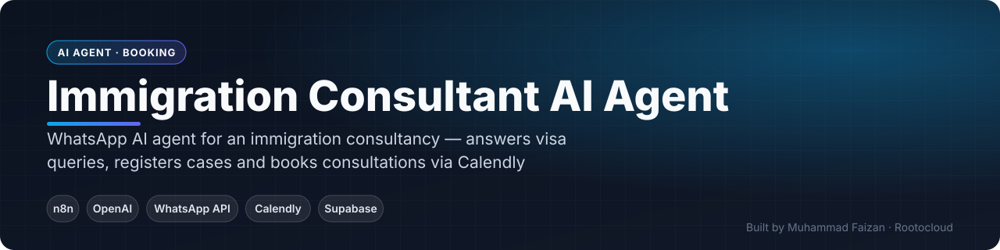
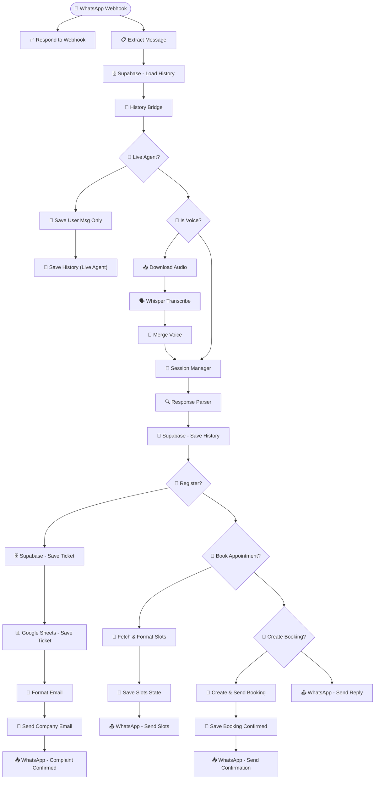

 

    

 

**[Get this built for your business](https://www.fiverr.com/faizan_develope) · [Rootocloud](https://rootocloud.com) · [More projects](https://github.com/MuhammadFaizan73)**

---

## 📌 Overview

A WhatsApp assistant for an immigration consultancy. It answers questions about visas and processes, understands voice notes, registers client cases as tickets, and books consultations by fetching live Calendly slots and creating the booking inside the chat.

## ✨ What It Does

- Text and voice-note understanding (Whisper)
- Case / complaint registration → Supabase, Google Sheets and email
- Live Calendly availability shown as choices in WhatsApp
- Booking created and confirmed inside the chat
- Conversation memory and live-agent handover

## 📈 Business Impact

Prospects get answers and a booked consultation in one WhatsApp conversation, with no back-and-forth emails.

## 🔀 How It Works

The diagram below is generated directly from the production n8n workflow.

### Workflow — 30 nodes

<!-- SCREENSHOTS -->
<!-- /SCREENSHOTS -->

## 🔒 About the Workflow File

This automation was built for a client, so the n8n workflow JSON (with prompts, credentials and business logic) is kept private.
**I can build a version tailored to your business** — [contact me on Fiverr](https://www.fiverr.com/faizan_develope) or [email](mailto:faizan.developer9200@gmail.com).

## 👨‍💻 Author

**Muhammad Faizan** — Founder, [Rootocloud](https://rootocloud.com) · n8n & AI Automation Specialist (8+ years)

© Muhammad Faizan. All rights reserved.

